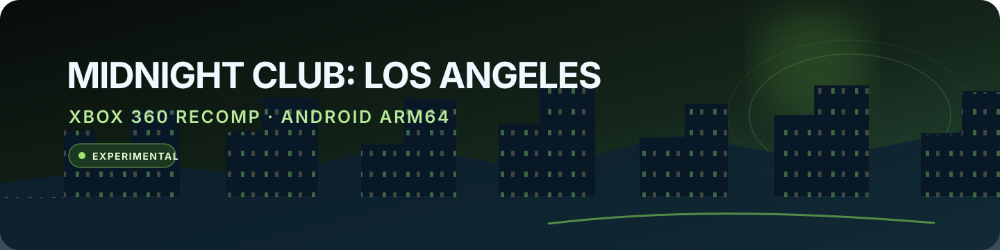

# Midnight Club: Los Angeles Recomp — Android ARM64

  

An experimental, community-made Android port of the Xbox 360 edition of *Midnight Club: Los Angeles Complete Edition*. This fork focuses on running the recompiled C++ game natively on Android ARM64, with development and testing centered on a Samsung Galaxy S23 using Termux.

**This project is experimental.** Earlier builds reached the city on the S23 but had very low performance. The latest documented build has not been launched during the current review, and current gameplay stability, file-open coverage, and frame rate are unverified. Other devices and GPUs have not been validated. The README does not promise that the game is playable or that 30 FPS is attainable.

## Project at a glance

| Area | Current scope |
|---|---|
| Target | Android ARM64; tested on a Samsung Galaxy S23 only |
| Recompilation | C++ generated from Xbox 360 PowerPC code using ReXGlue |
| Build workflow | Native build and APK packaging with Termux and Android SDK/NDK tools |
| Game data | User-provided files imported into app-private `filesDir/game` |
| Release state | Experimental; gameplay, stability, and FPS for the latest build are unverified |

## Start here

| Guide | What it covers |
|---|---|
| [Android build and import guide](android/README.md) | Termux build steps, private data import, requirements, and limitations |
| [V8 continuity summary](docs/CONTINUITY_SUMMARY.md) | Current implementation, what is verified, and what still needs device testing |
| [Launcher observations](docs/testing/android-ui-last-two-observations-2026-10-23.md) | What the two latest UI screenshots do and do not prove |
| [Historical platform notes](docs/OTHER_PLATFORMS_HISTORICAL.md) | Archived Windows/Linux/PS5 documentation, not active support for this fork |

The launcher imports user-provided game files into the app's private `filesDir/game` directory. The runtime is configured to read from that private directory. The APK does not include the game or its assets. Uninstalling the app removes imported game data and saves stored in its private directory.

## Building on Android

The current workflow builds the native ARM64 components on the Android device with Termux and packages them with the Android SDK/NDK and Java tooling. This avoids needing a separate build host, but a phone has less sustained CPU capacity, memory headroom, and cooling than a workstation. A full native build can therefore be slower, heat the device, and be more vulnerable to memory pressure or Android background process limits. Build tools and SDK components also consume substantial storage. The exact build requirements and commands are in the [Android guide](android/README.md).

## What this project is

ReXGlue statically recompiles Xbox 360 PowerPC code into C++, and supplies runtime components used by this project. This Android fork contains project-specific configuration, C++ changes, Android packaging and import code, and patches to ReXGlue. Recompilation does not make the game source or assets open source; users must supply their own legally obtained copy.

## Credits and references

- [ReXGlue SDK](https://github.com/rexglue/rexglue-sdk) — the recompilation toolkit and runtime used by this project. See its repository for its contributors and license.
- [Xenia](https://github.com/xenia-project/xenia) — acknowledged by ReXGlue as foundational upstream work for parts of its runtime. It is a reference in the dependency lineage, not a claim that this Android fork contains a separate Xenia port.
- [LARecomp](https://github.com/mzzvxm/LARecomp) — the source file comments identify specific menu, timing, performance-analysis, and warp-fix work adapted from LARecomp, with permission attributed there to its author. The affected files retain those attributions.
- [libadrenotools](https://github.com/bylaws/libadrenotools) — included as a Git submodule for optional Android GPU-driver integration. Its presence does not mean a custom driver is required or enabled on every device; the app has a system-driver fallback.

These credits describe references or components evidenced in this repository. They do not imply that this Android fork is a port of, or supported by, the Windows, Linux, or PS5 builds documented elsewhere in the former shared README. Archived platform notes, retained only as historical context, are in [OTHER_PLATFORMS_HISTORICAL.md](docs/OTHER_PLATFORMS_HISTORICAL.md).

## Copyright, game files, and trademarks

This is an unofficial, non-commercial fan and research project. It is not affiliated with, endorsed by, or sponsored by Rockstar Games or Take-Two Interactive. *Midnight Club* and related game materials remain the property of their respective owners. No game executable, disc image, proprietary asset, save, APK, or signing key is distributed in this repository. Do not upload or share copyrighted game files; obtain and use game data only as permitted by applicable law and the rights holder. A disclaimer does not grant rights or guarantee that a hosting service will keep the project available.

The project code is licensed under [GPL-3.0-or-later](LICENSE), except third-party components and material governed by their own licenses and notices. That code license does not cover the commercial game or its assets.

## AI assistance and apology

I apologize for relying heavily on AI assistance. My knowledge of C++ recompilation and Android porting is still limited, so I use AI as a helper for research, implementation, and review. That does not remove my responsibility for the changes: this project is heavily AI-assisted and can fairly be described as “vibecoded.” I am trying to do the best I can, and I ask for patience and clear corrections when something is wrong.

## Archived material

The repository still contains some shared/upstream platform scripts and conditional code. Their presence is historical and does not indicate that this Android-focused fork currently builds, tests, or supports those targets. See [the archived platform notes](docs/OTHER_PLATFORMS_HISTORICAL.md).
